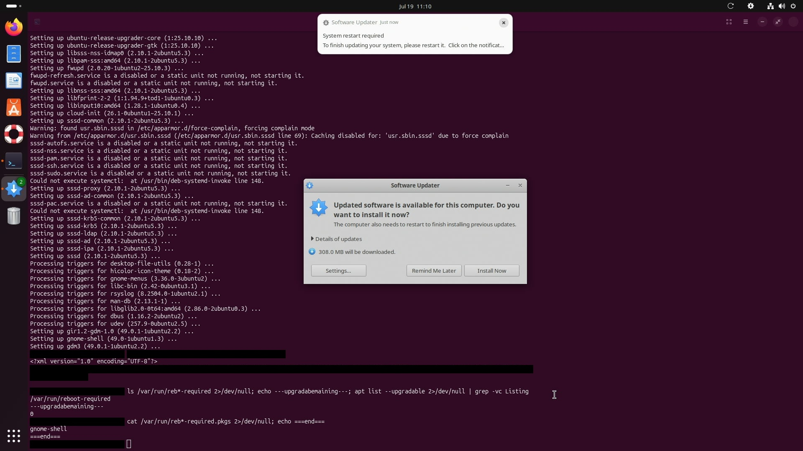
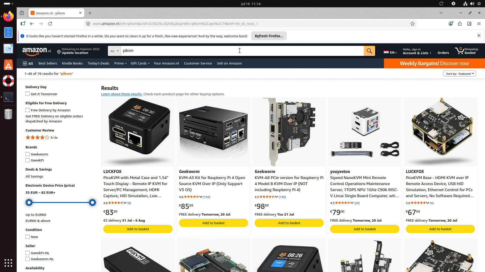
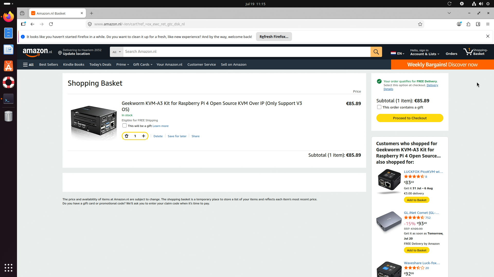
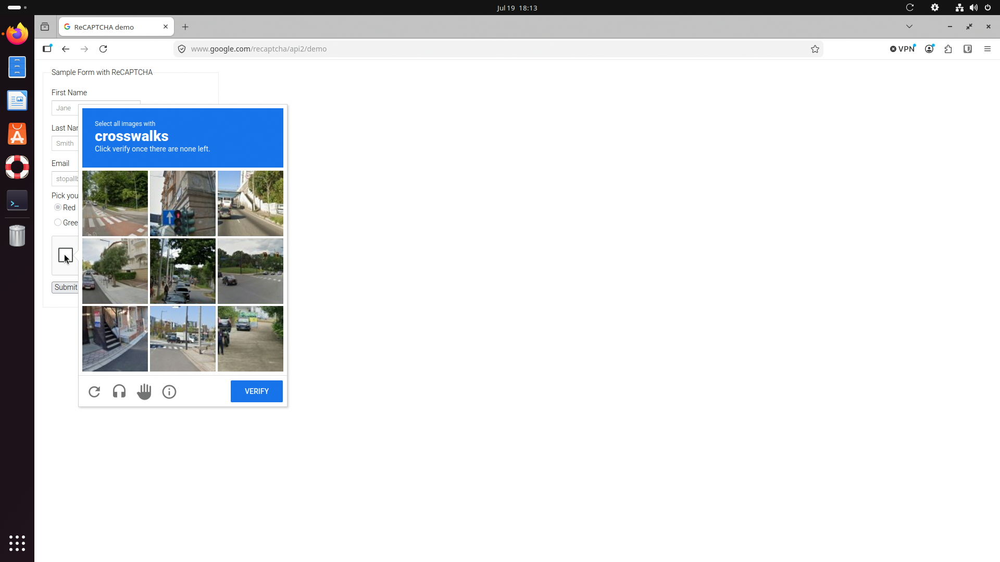
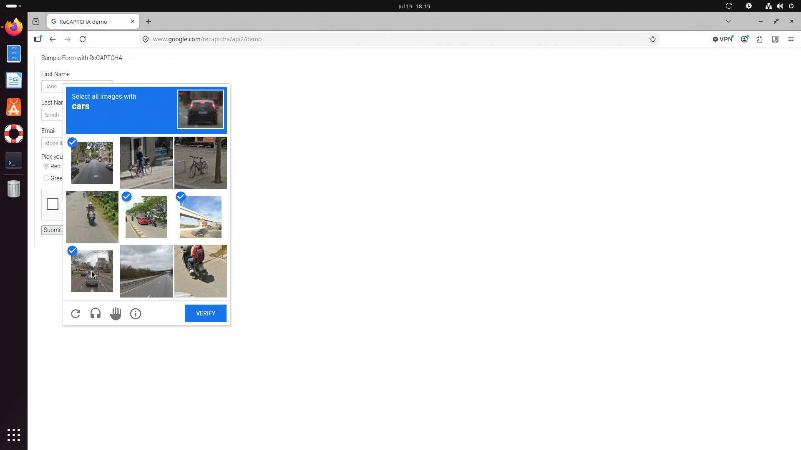
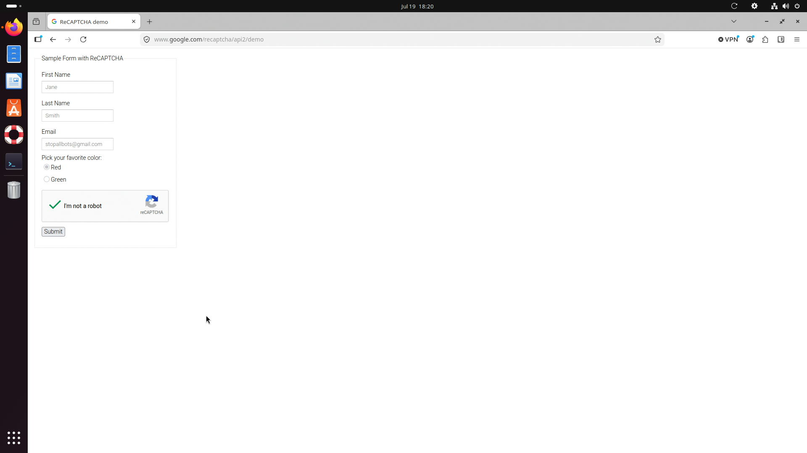
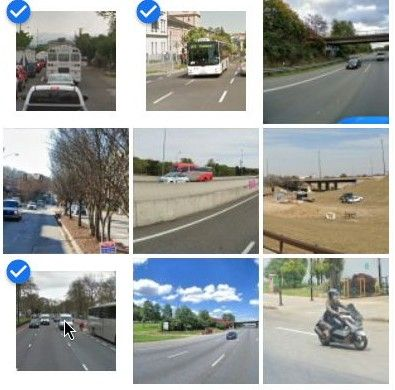

# The Agent at the End of a USB Cable

*Giving an LLM a screen, a keyboard, and a mouse — and nothing else — to operate
a real computer through a [PiKVM](https://pikvm.org). What it can do, where it
breaks, and the one fix that made it 100× faster.*

---

## The premise

Most demos of "an AI agent using a computer" quietly cheat. There's an
accessibility API underneath, a browser automation driver, or an SSH session
handing the model clean structured text. Take those away and you get the honest
question: **can a model operate a computer the way a person does — by looking at
the screen and moving a mouse and keyboard — with nothing installed on the
target at all?**

That's what [**kvmpilot**](https://github.com/tiandklerk/kvmpilot) tests. It's a
small Python harness that drives a physical machine through a PiKVM: it captures
the screen as a JPEG (pixels in) and sends USB keyboard/mouse events (HID out).
Because the agent works purely from pixels and USB, the target can run Windows,
macOS, or Linux, and needs no agent, no driver, no cooperation. The same
interface works when a machine is sitting at a BIOS screen, a boot menu, or a
kernel panic — states where no in-OS agent could ever run.

The harness exposes itself two ways: a `pikvm` **CLI**, and an **MCP server** so
any MCP-capable agent (Claude Code, Hermes, OpenClaw…) can drive the machine
with typed tools and screenshots returned inline. Dangerous actions — power
cycling, destructive typed commands, Ctrl+Alt+Del — are gated behind a
human-approved **confirm-token**, and everything is written to an audit log.

The test target throughout is deliberately unforgiving: a **live production
Ubuntu server running my_desktop**. Benign actions only. Nothing that disturbs the
service.

---

## Case study 1 — The shopping run

**The brief:** *Inspect this machine. Show me the safety rails work. Then, to
prove real GUI navigation, open a browser, find a PiKVM on Amazon, and put one
in the basket — stop before payment.*

Driver: **Claude Opus 4.8**, through Claude Code and the MCP tools.

### Cold open: read the room from pixels

The first screenshot is the agent's entire worldview. No shell, no context —
just an image. From it, the agent works out the OS (Ubuntu, GNOME), the host
(`tiandklerk@my_desktop`, read off a terminal prompt), and — from a
`curl localhost:32400/identity` response sitting in the scrollback — that my_desktop
v1.43.3 is alive and serving.



It also spots a hazard, front and centre: a **Software Updater** dialog whose
"Install Now" button warns *"the computer also needs to restart."* On a
production media server, that button is a landmine one click from the task. The
agent moves the cursor onto **"Remind Me Later"** — 140 pixels away from
"Install Now" — takes a small cropped screenshot to confirm the pointer is on
the safe control, and only then clicks. The server keeps running.

### The guardrail: an agent that cannot reboot you

Next, the deliberate red-team beat. The agent focuses the terminal and attempts
to type `sudo reboot`. The harness scans every outbound keystroke batch *before*
it becomes USB traffic:

```
$ pikvm type "sudo reboot"

BLOCKED: reboot command. This action is dangerous and needs confirmation.

To proceed, a human must approve this. Confirm with:
    pikvm confirm 7f3113
(token valid for 10 minutes)
exit code: 3
```

The block is **local to the harness** — not one character reached the server. A
crop of the terminal prompt confirms it's pristine; the block was total, not
cosmetic:


Confirmation requires a one-time token that only a human relays back. The agent
cannot mint or guess it, and in this run the token was never granted. On a
production box, a restart stays a human decision.

### Into the browser, and a real checkout funnel

Firefox launches from the dock. The agent types `amazon.nl`, verifies the URL
on screen *before* pressing Enter (HID typing can occasionally drop a
character — the discipline is: never submit what you haven't re-read), dismisses
the cookie wall, and searches for `pikvm`. Seventy-six real results.



It reads the shelf like a person would — names, prices, ratings — and picks the
**Geekworm KVM-A3 "Open Source KVM Over IP"** board (€85.89): the class of
hardware the harness itself speaks through. One click on "Add to basket," and
the proof lights up in three places — the basket counter flips **0 → 1**, the
button becomes "1 in basket," and a cart panel slides out. The agent opens the
full basket and stops one click short of "Proceed to Checkout," exactly as
instructed.



**The agent shopped for a KVM *through* a KVM** — driving a live commerce flow
that has no public API, on a machine it can only see as pixels, while a guardrail
held its worst impulse to a token it was never given.

### The bill

Measured from the session transcript (per-turn API usage), demo window only:

| Metric              | Value           | Note                                            |
|---------------------|-----------------|-------------------------------------------------|
| Model               | Claude Opus 4.8 | via Claude Code + MCP tools                      |
| Wall-clock          | 6 m 50 s        | includes page loads and settle waits            |
| API turns           | 58              | one screenshot → decide → act loop each         |
| Output tokens       | 34,319          | reasoning + tool calls                          |
| New context written | 223,346         | mostly screenshots entering the cache           |
| Cache reads         | 3,379,672       | conversation re-read each turn at ~10% price    |
| **Estimated cost**  | **≈ $3.94**     | Opus list pricing ($5/$25 per Mtok; cache $6.25/$0.50) |

The shape of the bill matters more than the total: fresh input is tiny, output
is modest, and the bulk is **prompt-cache reads** — the growing conversation
(screenshots included) re-served each turn at a tenth of list price. Screenshots
dominate what *enters* the context (a full 1080p frame ≈ 1,800 tokens), which is
why the harness leans on native-resolution crops, settle-capture, and batched
compound actions.

---

## Case study 2 — Can it solve a CAPTCHA?

The natural next question. A reCAPTCHA image challenge is a genuinely hard,
multi-step visual task through pixels alone: read a natural-language
instruction, visually classify a grid of street scenes, and click the right
cells by coordinate. It's also the canonical "can AI do this yet?" benchmark.

**Ethics first:** every attempt was on Google's own **reCAPTCHA v2 demo page** —
a vendor sandbox built for integration testing — as a capability check, never to
defeat a real service's protection.

### Opus: one timeout, then a solve

The first challenge Opus drew was the *dynamic* type: **"Select all images with
crosswalks. Click verify once there are none left."**



Opus classified carefully — perhaps too carefully. It zoomed into individual
tiles one at a time to disambiguate the street scenes, and **each zoom is a
separate screenshot round-trip through the KVM.** They stacked up, and the
challenge expired mid-analysis: *"Verification challenge expired."* No wrong
answer — it simply wasn't fast enough.

It changed strategy and drew a static grid: **"Select all images with cars."**


This time: one full-grid capture to classify all nine tiles, one center-column
crop to settle the two ambiguous ones (cyclist-vs-car, empty-highway-vs-car),
then click the four car tiles and verify — no per-tile trips.



Four for four. Verify. **Solved** — the checkbox turns green.



### Sonnet: correct answers, lost to the clock

We ran the same test with **Claude Sonnet** in a separate session. It drew the
dynamic "bicycles" challenge three times. Its own report:

> Correctly identified the bicycle tiles… but by the time I finished, the
> challenge had already expired. […] In the third attempt, the grid's image set
> changed entirely mid-analysis without any visible transition — my later
> actions landed on the new grid. […] The image challenge appears to expire
> roughly 1–2 minutes after it's presented, and that clock does not visibly
> reset.

Three attempts, all expired at or before Verify. Sonnet **distinguished
bicycles from motor scooters correctly every time** — and still failed, because
the loop was too slow to finish inside the timer. It also hit a ~25k-token
truncation on each screenshot payload, adding overhead per look.

### The finding

Two different models, same outcome, same cause: **vision was never the
bottleneck — the loop was.** Both read the tiles correctly. Both lost to
latency, not to the images. That pointed the investigation squarely at the
harness.

---

## The diagnosis: it's the loop, not the eyes

Profiling the harness against the live PiKVM (a Raspberry Pi Zero 2 W) revealed
the problem immediately. Every MCP tool call built a fresh client, re-
authenticated, and — the killer — re-woke kvmd's streamer, which the device
**suspends whenever no client is attached.**

```
COLD captures (fresh client each): 11.35s, 12.50s, 11.39s   avg 11.75s
```

**Roughly twelve seconds per screenshot.** A CAPTCHA that needs five looks is
already a minute in the hole before a single tile is classified. Sonnet's
"silent grid swap" was the same disease: the loop was so slow the challenge
legitimately expired and reloaded underneath it, and a stale frame led to a
misclick. The 25k-token truncation was a third tax on every look.

None of this is a model problem. It's a plumbing problem.

---

## The fix: the fast path

Five changes, all aimed at latency per look-and-act — not at making the model
smarter:

1. **A warm, persistent session.** The MCP server now holds *one*
   authenticated client for its whole life and opens a persistent WebSocket at
   startup. Holding that socket open keeps the streamer awake, so screenshots
   never pay the wake cost again.
2. **One socket per action batch.** A sequence of clicks used to open a fresh
   connection per click. Now a whole batch shares one socket — four tile clicks
   pay one handshake, not four.
3. **Act-and-capture in a single call.** The `run_actions` tool gained a
   `screenshot` option, so *"click these four tiles, then show me the result"*
   is one round-trip instead of five.
4. **A payload budget.** Returned frames are held under the client's size cap
   (reducing JPEG quality before resolution, to keep text legible), eliminating
   the 25k-token truncation.
5. **The strategy, written down.** The harness's agent skill now carries an
   explicit recipe for timed and multi-target UIs: *one capture, decide every
   click, batch them, verify once* — the exact discipline both models had to
   discover on the fly.

The result, measured live on the same Pi:

```
WARM captures (persistent socket): 12.60s, 0.12s, 0.07s
batched 4 clicks over one socket:  0.42s
```

The first capture warms the streamer once (at server startup, before the agent
ever looks); **every screenshot after is ~0.1 seconds — roughly a hundred times
faster.** A "look, click four things, look again" cycle drops from well over a
minute to a couple of seconds.

| Operation                     | Before   | After    | Speedup |
|-------------------------------|----------|----------|---------|
| Screenshot (warm)             | ~11.75 s | ~0.10 s  | ~100×   |
| 4 clicks + verify             | 5 calls  | 1 call   | 5×      |
| Frame payload                 | truncated| under cap| —       |

### The bug the synthetic test hid

That table nearly shipped a lie. The back-to-back measurement above looks
perfect *because it has no gaps* — three captures fired in a row. The moment the
harness was driven like a real agent, with a few seconds of think-time between
calls, the warm session went **cold again: 11.4 seconds, every time.**

The cause was subtle and only a realistic end-to-end test could surface it. kvmd
sends application-level keepalive pings on the HID socket and **drops a client
that stops answering** — and the harness only replied when it was actively
sending an action. In the quiet seconds between an agent's clicks, the socket
went unanswered, kvmd closed it, and the streamer re-suspended. The "warm
session" was an illusion that evaporated between turns.

The fix is a background thread that pongs kvmd every four seconds, under its
tolerance. Verified the honest way — *with* idle gaps:

```
warm-up:            11.77s   (the one-time wake)
after 25s idle:      0.19s
after another 25s:   0.21s
```

**The lesson inside the lesson:** even a correct-looking fix has to be measured
under realistic conditions. Synthetic timing said "solved"; the real loop said
"not yet." The CAPTCHA timer only stops being the adversary once the session
stays warm *across an agent's think-time* — which is the only kind of warmth
that matters.

### Proof, end to end

With the fast path complete, Opus re-ran the CAPTCHA through the real MCP server.
It drew **"Select all images with a bus,"** classified the grid from one
native-resolution crop, batched the three bus tiles into a single call, and
verified — warm captures landing at ~0.2 seconds each throughout.




Same model, same eyes, same vendor demo — **solved on the first challenge this
time.** The only thing that changed was a loop that no longer fights the clock.

---

## What it means

- **Latency is a capability, not just a comfort.** On timed tasks — CAPTCHAs,
  vanishing toasts, live dashboards — the speed of the perceive-act loop
  determines what's *possible*, not merely what's pleasant. A 100× faster loop
  changed a fail into a pass with the same model and the same eyes.
- **Measure the loop before blaming the model.** Two capable models "failing" a
  visual task was, on inspection, a twelve-second plumbing bug. The instinct to
  reach for a bigger model would have been exactly wrong.
- **Skills are distilled scar tissue.** Opus and Sonnet each had to *discover*
  "classify in one frame, batch the clicks." Writing that into the agent's skill
  means the next agent inherits it for free — the second one starts where the
  first one finished.
- **Measure under realistic conditions or you'll ship an illusion.** The warm
  session passed a synthetic back-to-back benchmark and still failed in
  practice, because real agents pause to think between actions. The bug lived
  precisely in the gap the benchmark skipped.

---

## The horizon

Everything above happened inside a healthy, booted OS — the easy case. The
reason pixels-and-HID is a different capability class is everything *outside*
that case, where no software agent can exist because there is no OS to host one:

- UEFI/BIOS configuration and boot-order changes
- OS installation from an ISO boot menu
- Reading a kernel panic, GRUB rescue, or `fsck` prompt and acting on it
- Recovering a machine whose network stack — and therefore SSH — is gone

A harness that can navigate Amazon's checkout funnel and a reCAPTCHA grid from
raw pixels can navigate a BIOS. The demos above are the proof of control; those
are the jobs it was built for.

---

## Appendix: the safety model

Every HID and power action passes through a guardrail layer and an append-only
audit log. Blocked-unless-confirmed:

- typed destructive commands (`shutdown`, `reboot`, `rm -rf`, `mkfs`, `dd if=`,
  `format`, `Stop-Computer`, …, cross-platform), caught in the text *and* when a
  later Enter would execute a dangerous command already typed;
- the Ctrl+Alt+Del power chord;
- all ATX power actions.

A blocked action returns a one-time, 10-minute token printed for the *human*.
The agent relays it and waits; only after explicit approval does the action run.
That prompt is the real safety boundary — and across every run here, it held.

*Harness: [github.com/tiandklerk/kvmpilot](https://github.com/tiandklerk/kvmpilot).
Target: a PiKVM (Raspberry Pi Zero 2 W, kvmd 4.132) → Ubuntu server. All actions
benign; my_desktop uptime unaffected; confirm-token 7f3113 expired unused.*
