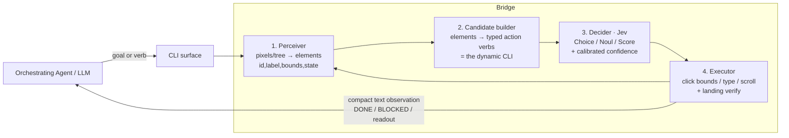

# Design: The GUI→CLI Bridge (Jev-driven perception + decision layer)

**Status:** Draft / RFC
**Author:** Tian de Klerk (with Claude Opus 4.8)
**Date:** 2026-09-29
**Working name:** `gui-cli-bridge` (codename suggestion: **`deckhand`** — the pilot gives orders, the deckhand carries out deck-level actions). Jev-specific naming is deliberately avoided; Jev is one pluggable decision backend.
**Consumers:** kvmpilot (PiKVM / pixels-only) and phonepilot (Android / accessibility tree) first; then a standalone tool for other agent–computer systems.

---

## 1. TL;DR

Today an orchestrating LLM agent drives a GUI by *looking at pixels every step*: screenshot → reason about the image → guess coordinates → click → screenshot again. That loop is slow, expensive, and — for coordinate grounding specifically — unreliable (published GUI agents ground correctly on only single-digit-percent of hard cases without a dedicated grounder).

This design introduces a **bridge** that turns any GUI into a **dynamic, typed CLI** that an agent drives instead of the pixels. The bridge has three layers:

1. **Perception** — turn the current screen into a structured list of on-screen elements (`id`, label text, bounds, state). Pluggable per surface: accessibility tree (Android/web) or a local detector + OCR (PiKVM pixels).
2. **Decision (Jev)** — given the structured state + a typed question, Jev returns *one* calibrated typed answer **fast and cheap**: pick element *N* / true-false / a score. Coordinates are looked up from the chosen element's bounds — **Jev never emits coordinates and never sees pixels.**
3. **Execution** — perform the resolved action (click at the element's bounds, type text, scroll) with landing-verification, and hand a compact text observation back to the agent.

The agent now issues intents like `click "Sign in"` or `resolve <goal>` against a **CLI whose available verbs are the elements currently on screen** — a "dynamic CLI." It stops burning tokens on image reasoning; the bridge handles perception and low-level target selection.

**The premise correction that shapes this whole design:** Jev does **not** do image processing and does **not** return coordinates. It is a *typed decision model* over text/structured state. This is confirmed by four independent sources (TypeSafe blog, OpenRouter docs, `madewithjev.com/jev-images`, and the Jev-Mobile paper). The perception layer is therefore not optional — it is the part that does the "seeing," and it is where most of the reliability risk lives.

---

## 2. Background

### 2.1 What Jev actually is (verified)

Jev is TypeSafe's "System One" model: a **fast, cheap, calibrated, typed decision model**.

- **Input:** a `state` (structured or text) + typed `questions`. **32k context. Text/structured only — not images.**
- **Output:** always a valid instance of one of three typed primitives, each with probabilities/confidence:
  - **Choice** — pick 1 of N options, with a per-option probability.
  - **Noul** — a boolean, with the probability of "yes."
  - **Score** — a position on an ordered scale.
  - There is **no coordinate output type.**
- **"Can't hallucinate / zero type errors"** means the output is *always* a well-formed instance of the requested type — **not** that the decision is always correct. Decisions are *calibrated*: the reported probability is meant to track real accuracy, so you gate on it.
- **Speed/cost (vendor-reported):** ~70–500 ms per decision (sub-100 ms claimed), input ~$0.042/MTok, output free; **median decision ≈ $0.000068.**
- **Access:** OpenRouter Decisions API — `POST https://openrouter.ai/api/alpha/decisions` (alt `POST /api/v1/systemone`); model IDs `typesafe/jev-1.13`, `~typesafe/jev-latest`. Also available via Vercel AI Gateway. **BYOK** — needs `OPENROUTER_API_KEY` (supplied later; never hardcode, never log, never send anywhere else).

> Provenance note: these facts are from post-cutoff vendor / OpenRouter / community sources, cross-checked and mutually consistent, but not independently benchmarked by us. Numbers should be re-verified against `docs.typesafe.ai` when we wire up keys.

### 2.2 The "System One + LLM + Code" split (the official pattern)

`madewithjev.com` frames the pattern TypeSafe calls **Jev Engineering**:

- **LLM** — generates text, plans, reasons about open-ended things (slow, expensive, flexible).
- **Jev (System One)** — makes fast typed categorical/binary decisions from structured state (the reflex layer).
- **Code** — deterministically builds the options and executes the chosen action.

Concrete instance from the catalog (WebMCP): *Jev selects which tool to call; a small LLM (Mercury) generates the arguments* → reported "100% task completion (49/49) at 112× lower cost than a frontier chat model." That division — **Jev picks the verb, an LLM fills the args** — is exactly what we need for text entry (Jev picks the field to type into; the agent/LLM supplies the string).

### 2.3 How Jev is given "vision" (the blueprint for pixels-only surfaces)

`madewithjev.com/jev-images` is explicit: *"Jev accepts text and structured state, so a picture has to become text before the decision."* Its **UI / Computer-Use** recipe is the direct model for kvmpilot:

> A local CoreML model segments buttons and UI elements; on-device OCR reads labels. The output — element coordinates and text — feeds to Jev, which returns a probability across those elements and tells me the best one to click.

Two things to take from this:

1. The vision layer can be **small and local** (a CoreML-class segmenter + on-device OCR), not necessarily a heavyweight VLM. Coordinates come from the *detector/OCR*, and Jev just chooses among the detected elements.
2. **The calibration trap — "scores do not stack":** *"An OCR score, a detector score and Jev's confidence are different numbers, so a confidently misread image can be routed just as confidently."* Jev's confidence reflects *its decision given the (possibly wrong) structured state* — it cannot know the perception was wrong. **End-to-end reliability is bounded by the weakest layer, usually perception.** This is the single most important risk in the design (§8).

### 2.4 The Jev-Mobile paper (arxiv 2609.30186) — the reference architecture

The paper describes an Android agent built on exactly this split, and it is the closest existing system to what we want:

- **VLM = low-frequency planner.** Reads task + screenshot + tree + history → emits a *local goal*, the *exact text* to enter if needed, and a control token `{delegate, finish, blocked}`.
- **A deterministic candidate-builder program** enumerates executable actions from the **accessibility tree**: each candidate = a local ID + node/bbox + a short label. Visible/enabled/valid-bounds nodes become `click` / `long-press` / `scroll` / `focus` / `input` candidates.
- **Jev = high-frequency executor.** One typed Choice per call: pick a candidate ID, or `DONE` / `BLOCKED`. It can run several actions to satisfy one VLM goal before handing back.
- **Coordinates come from tree node bounds, never from Jev.** There is **no coordinate-producing visual fallback** — if a target isn't in the tree, the agent `BLOCK`s rather than guessing. (Also noted: non-ASCII text input is a limitation of the input path.)

The accuracy/robustness tradeoff is real and worth stating up front: the paper's split trades a little top-line task accuracy (roughly ~0.79 vs ~0.84 for a heavier all-VLM approach in their numbers) for large gains in latency and cost per step. That is the trade this design is making on purpose.

### 2.5 Where our surfaces sit

| Surface | Structured state available? | Perception plugin needed | First-cut difficulty |
|---|---|---|---|
| **phonepilot** (Android) | Yes — UIAutomator `ui_dump` tree (free) | Tree → candidates (thin) | **Low — near drop-in** |
| **Web** (future) | Yes — DOM | DOM → candidates | Low |
| **kvmpilot** (PiKVM) | **No — pixels only** | Local detector + OCR → candidates | **High — the vision layer is the work** |

kvmpilot already ships several of the needed primitives in its MCP surface: `screenshot`, `screen_ocr`, `wait_for_stable`, `mouse_click`, `mouse_move`, `type_text`, `run_actions`. phonepilot already ships `ui_dump`, `run_actions`, and landing-verified taps (`tap_verified` / `tap_landed`). So a lot of Layer 1 and Layer 3 exists; the new parts are the candidate-builder, the Jev decision call, and the dynamic-CLI framing.

---

## 3. What changed after studying the real use cases

I went in planning a three-layer perception→Jev→execute pipeline. The `madewithjev` catalog and `jev-images` page **reinforced and sharpened** that rather than overturning it:

1. **Confirmed, four times over, that Jev is not the eyes.** Every reliability decision now assumes perception is a separate, fallible layer. No "let Jev look at the screen" shortcut exists.
2. **The vision layer can be small/local.** I no longer assume kvmpilot needs a big grounding VLM (UI-TARS et al.) as a hard dependency. A lightweight local detector + OCR (the CoreML pattern) is the *baseline*; a bigger grounder is an optional accuracy upgrade, not a prerequisite.
3. **"Scores do not stack" gets promoted to a first-class design constraint** (§8), tied directly to verification machinery we already built in phonepilot (`tap_verified`) and kvmpilot (`wait_for_stable`, `screen_ocr`).
4. **The verb/args split is now explicit:** Jev chooses the target/verb; an LLM (or the calling agent) supplies free-form arguments (text to type). This shapes the CLI contract (§5).
5. **Decider backend is pluggable, not hardwired to Jev.** The catalog names open System One alternatives (CUA-S1-FORMS ~706k params, Julia/Laya/von, Mercury) and Vercel AI Gateway routing. We isolate Jev behind a `Decider` interface so a self-hosted/OSS model or even a small LLM can be swapped in — this also hedges vendor lock-in and the alpha-endpoint risk.

Net: the plan stands; it gets a smaller default vision dependency, a hardened stance on calibration, and a pluggable decider.

---

## 4. Architecture



### Layer 1 — Perceiver (pluggable, per surface)

**Contract:** `perceive(surface) -> Observation`, where an `Observation` is a stable, serializable snapshot:

```jsonc
{
  "surface": "android|web|pikvm",
  "frame_id": "monotonic id / hash of the frame",
  "size": [w, h],                 // pixel space; coordinates are in this space
  "elements": [
    {
      "id": "e12",               // stable within this observation
      "role": "button|text|field|checkbox|link|image|...",
      "label": "Sign in",        // OCR text or a11y name (may be empty)
      "bounds": [x, y, w, h],     // source of truth for coordinates
      "state": {"enabled": true, "focused": false, "checked": null},
      "confidence": 0.97          // perception confidence (detector/OCR) — SEPARATE from Jev's
    }
  ],
  "scrollables": [ ... ]          // regions that can scroll to reveal more
}
```

Implementations:
- **AndroidPerceiver** — parse `ui_dump` (UIAutomator XML) → elements. Bounds and roles are given by the tree; `confidence` ≈ 1.0 (it's structured, not inferred).
- **WebPerceiver** (future) — DOM query → elements; bounds from `getBoundingClientRect`.
- **PixelPerceiver** (PiKVM) — `screenshot` → local element detector (segments buttons/fields/icons) + OCR (kvmpilot already has `screen_ocr`) → elements with `bounds` from the detector and `label` from OCR. This is the "make the picture into text" stage; its per-element `confidence` is where §8 bites.

### Layer 2 — Candidate builder (deterministic code)

Turns `elements` into the **typed action space** — the *dynamic* part of the CLI. For each element, emit the executable verbs it supports:

```jsonc
{
  "candidates": [
    {"cid": "c0", "verb": "click",      "target": "e12", "label": "Sign in"},
    {"cid": "c1", "verb": "type_into",  "target": "e4",  "label": "Email"},
    {"cid": "c2", "verb": "scroll",     "target": "r0",  "dir": "down"},
    {"cid": "c3", "verb": "long_press", "target": "e12", "label": "Sign in"}
  ],
  "controls": ["DONE", "BLOCKED"]      // always available to the decider
}
```

Rules (from the Jev-Mobile candidate-builder): only *visible, enabled, valid-bounds* elements become candidates; the option set is small and fully enumerated so Jev makes a **closed-set Choice** (no free-form target-picking). This candidate set *is* the "dynamic CLI" for the current screen — it changes every observation.

### Layer 3 — Decider (Jev; pluggable)

**Contract:** `decide(state, question) -> TypedAnswer{value, confidence, per_option?}`.

- For target selection: a **Choice** over `candidates + controls`. State = the task/goal + the candidate list (labels, roles) + short history. Jev returns the chosen `cid` (or `DONE`/`BLOCKED`) + calibrated confidence + per-option probabilities.
- For yes/no gates ("has the page finished loading?", "is this the right screen?"): a **Noul**.
- For ranking/thresholds ("how confident this is the login form"): a **Score**.

Backends behind this interface: **JevDecider** (OpenRouter `/api/alpha/decisions`, `~typesafe/jev-latest`), plus room for an OSS/self-hosted System One model or a small-LLM fallback. The endpoint is *alpha*, so treating it as swappable is a hedge, not just tidiness.

### Layer 4 — Executor

Resolve the chosen candidate to an action on the element's **bounds** (center of `bounds`, or a held press for long-press) and perform it with **landing verification**:
- Android: reuse `tap_verified` (held press + frame-diff / `tap_landed` inject-confirm) and `run_actions`.
- PiKVM: `mouse_click` then `wait_for_stable`; re-`screen_ocr` the target region to confirm the expected change.
Then produce a compact **observation/readout** for the agent — not the raw frame: "clicked 'Sign in'; screen changed; now on: <top labels>" or a `screen_ocr` readout of the requested region.

---

## 5. The dynamic-CLI contract (what the agent talks to)

The bridge exposes two interaction levels. The agent chooses per call.

### Level A — low-level, one action per call (agent stays in control of the loop)

```
observe                         → Observation (elements + candidate verbs) as compact text
click "<label>"                 → bridge asks Jev to pick the best matching candidate, executes, returns readout
type_into "<label>" "<text>"    → Jev picks the field; executor types <text>; returns readout
scroll <dir>                    → executes; returns readout
read [region|"<label>"]         → screen_ocr / a11y text readout, no action
```

`click "Sign in"` does **not** require the agent to give coordinates or even an exact string — the label is matched against the current candidates *by Jev* (calibrated fuzzy match over the closed set), and the executor uses the element's bounds. If Jev's confidence is below threshold or nothing matches, the bridge returns `AMBIGUOUS` with the top candidates, or `BLOCKED`.

### Level B — goal delegation, many actions per call (the Jev-Mobile executor loop)

```
resolve "<local goal>" [--enter "<exact text>"] [--max-steps N]
```

The bridge runs the high-frequency loop internally: perceive → build candidates → Jev picks one → execute → repeat, until Jev returns `DONE` or `BLOCKED` or `max-steps`. Returns: outcome (`DONE`/`BLOCKED`/`BUDGET`), step trace (verbs + labels + confidences), and a final readout. This is where the token/latency win is largest — the agent spends one LLM turn to delegate a multi-tap sub-goal.

**Verb/args split:** the *target* is chosen by Jev; any *free-form argument* (text to type) is supplied by the caller (agent/LLM). The bridge never invents text to type.

### Output discipline (why this is cheaper for the agent)

Every bridge response is **compact text**, never a raw screenshot by default: candidate labels, the action taken, confidences, and a short readout. The agent reasons over text, not pixels. A raw frame is returned only on explicit `screenshot`/debug request.

---

## 6. Per-surface plans

### 6.1 phonepilot (Android) — first target, near drop-in

- **Perceiver:** wrap existing `ui_dump` → `Observation`.
- **Candidate builder:** port the Jev-Mobile rules (visible/enabled/valid-bounds → verbs).
- **Decider:** JevDecider.
- **Executor:** existing `run_actions` + `tap_verified` (held press, inject-confirm landing check).
- **New surface:** add a `resolve` / `decide` verb to the phonepilot MCP server backed by the loop above.
- This validates the Jev Decisions API, the CLI contract, and calibration on a surface where perception is *free and near-perfect*, so any failures isolate to the decision/execution layers — the right place to start.

### 6.2 kvmpilot (PiKVM) — the harder, higher-value target

- **Perceiver (the actual work):** `screenshot` → local element detector + OCR (`screen_ocr` exists). Baseline = lightweight local detector (CoreML/OmniParser-class) per the `jev-images` recipe; optional upgrade = a stronger GUI grounder (UI-TARS / OS-Atlas / OmniParser) behind the same `Perceiver` interface.
- **Candidate builder / Decider:** identical interfaces to Android — the whole point of the split is surface-independence above Layer 1.
- **Executor:** `mouse_click`/`mouse_move`/`type_text` + `wait_for_stable` + region `screen_ocr` verify. Reuse the mouse-mode auto-switch and coordinate/HID math already in kvmpilot.
- **Blocking policy:** like Jev-Mobile, **no coordinate guessing.** If the detector doesn't produce a candidate for the target, return `BLOCKED` rather than clicking a hallucinated point. (This is a deliberate reliability choice; a "click at raw coordinate" escape hatch can be added later behind an explicit flag.)

---

## 7. Jev Decisions API integration

- **Endpoint:** `POST https://openrouter.ai/api/alpha/decisions` (fallback `/api/v1/systemone`). Model `~typesafe/jev-latest` (pin `typesafe/jev-1.13` for reproducible eval runs).
- **Auth:** `OPENROUTER_API_KEY` from env / secret store; **never** hardcoded, logged, or sent to any non-OpenRouter host. Do not include the user's email in any header/payload.
- **Request shape (to confirm against `docs.typesafe.ai` once keys arrive):** `{state, questions:[{type: "choice|noul|score", options?}]}`.
- **Budgets / gating:**
  - Latency budget per decision: target ≤ 300 ms; alert if p95 > 600 ms.
  - Cost tracking: log per-decision cost; expect ≪ $0.001. A `resolve` of ~8 steps should be well under a cent.
  - **Confidence gates** (calibrated): act only if Jev's chosen-option probability ≥ τ_act (start 0.85, tune on eval); below that → `AMBIGUOUS`/re-perceive/hand back to agent.
- **Isolation:** all of this lives behind `JevDecider implements Decider`, so a self-hosted System One model, a small LLM, or Vercel AI Gateway routing can replace it without touching Layers 1/2/4.

---

## 8. The central reliability problem: scores do not stack

This is the section to get right; everything else is plumbing.

**Statement.** Perception confidence, OCR confidence, and Jev's decision confidence are *independent numbers*. Jev is calibrated *conditional on the structured state it was given*. If the perceiver mislabels a button ("Cancel" read as "Confirm") or misses/merges elements, Jev will choose **confidently and wrongly**, and its high confidence tells you nothing about the perception error. End-to-end accuracy is bounded by the weakest layer, and it is almost always perception on the pixel surface.

**Mitigations (layered):**

1. **Don't trust a single confidence; calibrate end-to-end.** Build a labeled eval set per surface and measure *task* success vs Jev-confidence *and* perception-confidence jointly. Set gates on the *combination*, not on Jev alone.
2. **Cross-check perception against action outcome (we already have the tools).** After executing, verify the world actually changed as expected: Android `tap_verified` (frame-diff / inject-confirm), PiKVM `wait_for_stable` + region `screen_ocr`. A confident decision that produces *no expected change* is treated as a miss → retry/re-perceive/`BLOCKED`, not success.
3. **Semantic readback before consequential actions.** Before an irreversible/consequential verb, `read` the target element/region and compare to intent (this is the two-layer confirm pattern already in the repos). Ties into kvmpilot's existing `confirm_action`.
4. **No coordinate guessing.** Absent a candidate → `BLOCKED`. Prevents "confident click into the void."
5. **Prefer structured state when available.** Perception confidence ≈ 1.0 on Android/web; that's why we prototype there first and treat pixels as the hard mode.
6. **Human/agent escalation on low combined confidence,** with the top-N candidates surfaced as text so the orchestrating LLM can break the tie using its own reasoning.

---

## 9. Standalone tool shape

So other agent–computer systems can adopt it, keep the core surface-agnostic:

```
gui-cli-bridge/
  core/
    observation.py      # Observation / Element schema (stable contract)
    candidates.py       # candidate builder (surface-independent rules)
    decider.py          # Decider interface + JevDecider (+ stubs for OSS/LLM)
    executor.py         # Executor interface (+ verify hooks)
    loop.py             # the resolve() high-frequency loop
    gates.py            # confidence/calibration gating
  perceivers/
    android.py          # wraps phonepilot ui_dump
    pixel.py            # detector + OCR (wraps kvmpilot screen_ocr)
    web.py              # (future) DOM
  cli/                  # the dynamic-CLI surface (Level A + Level B)
  eval/                 # per-surface calibration datasets + harness
```

Interfaces (`Perceiver`, `Decider`, `Executor`) are the contract; kvmpilot and phonepilot provide concrete `Perceiver`/`Executor` implementations and consume the same `core`. Extraction to its own repo is a later step (§10); for now the doc and first implementation live in kvmpilot (the anchor), with phonepilot as the first integration.

---

## 10. Phased plan & UAT gates

Each phase ends at a **UAT gate** (matches the kvmpilot process): no live-device test is declared passing without evidence.

- **Phase 0 — Contracts (no device).** Land `Observation`/`Element`/`candidates`/`Decider` schemas + a mock `Decider` and mock perceiver; unit tests. *Gate:* schemas reviewed, tests green against mocks.
- **Phase 1 — Jev smoke test.** With keys, hit `/api/alpha/decisions` on canned states; validate typed outputs, confidence, latency, cost against §7 budgets. *Gate:* real Jev call returns a valid Choice within budget; costs logged.
- **Phase 2 — phonepilot integration (structured state).** AndroidPerceiver + candidate builder + JevDecider + existing `tap_verified` executor; add `resolve`/`click`/`type_into` verbs. Calibrate gates on a small Android task set. *Gate:* live Android UAT — a multi-step task completed via `resolve`, with the calibration report (Jev conf vs task success).
- **Phase 3 — kvmpilot PixelPerceiver.** Local detector + OCR → candidates; `mouse_click`+`wait_for_stable` executor with region-OCR verify; blocking policy. Re-calibrate on pixels. *Gate:* live PiKVM UAT on the standing Ubuntu/Plex target, honouring the live-test constraints; report end-to-end success + where perception (not Jev) caused failures.
- **Phase 4 — Standalone extraction.** Move `core` + `perceivers` to their own repo; kvmpilot/phonepilot depend on it. *Gate:* both consumers pass their suites against the extracted package.

Guardrails throughout: never commit to `main`; branch + PR; agents open PRs, humans merge; no self-merge; secrets only from env; live tests obey the existing kvmpilot/phonepilot constraints.

---

## 11. Success metrics

Measured against the baseline "agent eyeballs a screenshot every step":

- **Latency:** median per-step decision ≤ 300 ms (Jev) + perception; a `resolve` sub-goal completes without an LLM turn per tap.
- **Cost:** per-step decision ≪ $0.001; report cost-per-completed-task vs the all-LLM baseline (target order-of-magnitude cheaper, per the WebMCP 112× claim as an upper aspiration).
- **Reliability:** task success rate on the per-surface eval set; **and** the calibration curve (does acting only above τ_act give the promised success rate?). Explicitly track the accuracy trade vs an all-VLM approach (expect a few points lower, à la 0.79 vs 0.84) bought with large latency/cost wins.
- **Failure attribution:** every failed step tagged perception / decision / execution — expect perception-dominant on pixels (§8), which tells us where to invest.

---

## 12. Risks & open questions

| Risk | Impact | Mitigation |
|---|---|---|
| **Scores don't stack** — confident perception error → confident wrong action | High (esp. PiKVM) | §8: end-to-end calibration, outcome verification, semantic readback, no coord-guessing |
| **PiKVM perception cost/quality** — detector+OCR on frames is the real work | High | Start local/lightweight (CoreML pattern); upgrade grounder behind same interface; prototype on Android first |
| **Alpha endpoint / vendor lock-in** — `/api/alpha/decisions` is early; Jev is proprietary | Medium | `Decider` interface; OSS System One / small-LLM fallback; pin model id for eval |
| **Accuracy trade** — split loses a few points vs all-VLM | Medium | Accept consciously for latency/cost; measure it; keep an all-VLM escalation path |
| **Text entry / non-ASCII** — input path limits (from paper) | Medium | LLM supplies args; test IME/non-ASCII explicitly; document limits |
| **Coverage gaps** — target absent from tree/detector | Medium | `BLOCKED` + surface candidates to agent, don't guess |
| **Latency of full loop** — perceive+Jev+execute+verify per step | Medium | Batch (`run_actions`), compact readouts, `resolve` amortizes over steps |

**Open questions (to resolve with keys / docs):**
1. Exact Decisions API request/response schema and rate limits (`docs.typesafe.ai`).
2. Best local detector for PiKVM frames on our hardware (CoreML-class vs OmniParser vs UI-TARS) — accuracy/latency bake-off in Phase 3.
3. Do we want the raw-coordinate escape hatch on PiKVM at all, or hold the line on "no guessing"?
4. Standalone repo now vs after Phase 3 — proposed: after Phase 3.

---

## Appendix A — Evidence: Jev use cases (from madewithjev.com)

Browser automation (flight search ~7 s, ~$0.0039, step = Jev picks next action from DOM); **WebMCP** (Jev selects tool + small LLM args → "49/49, 112× cheaper"); large-scale classification (email/paper/lead/ad routing, cents-per-thousands); real-time gaming (Mario; Minecraft Ender Dragon 8m43s / $0.97 — decisions from game state); trading/routing/model-selection/SEO; **DocJev** (OCR + Jev doc classification). Median decision ≈ $0.000068; median latency sub-250 ms. Ecosystem: Vercel AI Gateway, Ultrafast Browser Use harness, OSS System One models (CUA-S1-FORMS ~706k params ~50 ms; Julia/Laya/von <15 ms / <421M params; Mercury for arg-gen).

## Appendix B — References

- TypeSafe blog — *Introducing System One models and Jev*: https://typesafe.ai/blog/introducing-system-one-models-and-jev
- Jev use cases: https://madewithjev.com/ · Vision preprocessing: https://madewithjev.com/jev-images
- OpenRouter Decisions API — `~typesafe/jev-latest`, `typesafe/jev-1.13`
- Jev-Mobile paper — arXiv 2609.30186 (local copy provided by author)
- TypeSafe docs — docs.typesafe.ai (to consult when keys are provisioned)
- Related in-repo work: kvmpilot MCP tools (`screen_ocr`, `wait_for_stable`, `mouse_click`, `confirm_action`); phonepilot `ui_dump`, `run_actions`, `tap_verified`/`tap_landed`.
